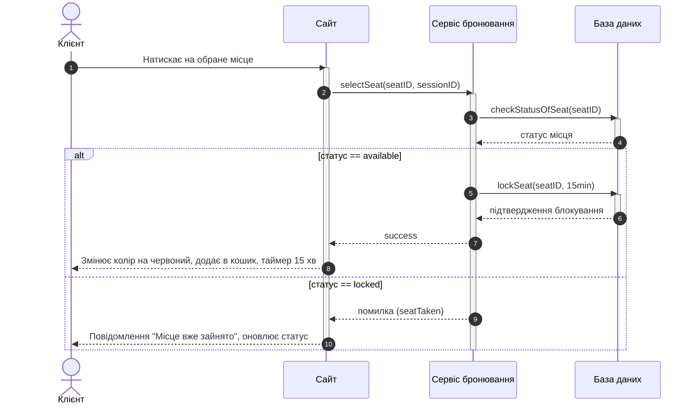
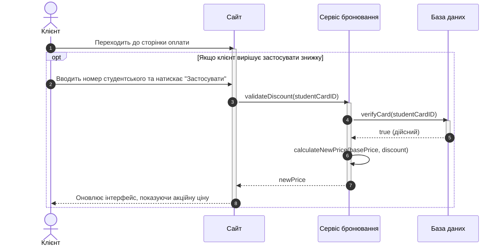

# Слід взаємодії з АІ — Лабораторна робота №3 (Sequence Diagram)

Цей документ фіксує хронологічну історію постановки задач, ітеративного уточнення специфікації (`spec.md`), проведення аудиту та генерації артефактів за допомогою ШІ.

---


## Етап 1: Перша ітерація специфікації (`spec.md`) та первинний аудит

**Промпт студента (початкова чернетка `spec.md` власноруч):**
> ```markdown
> # Use Case: Купівля квитка
> ## Опис
> - обраний кейс являє собою процес купівлі квитка в кінотеатрі від моменту як користувач відкрив сайт кінотеатру до успішної транзакції з чеком про оплату 
> ## Сценарії обраного варіанту
> - Вибір вільного місця
> - Студентська знижка
> - Логіка вибору та відхилення місця
> - Блокування місця при бронюванні на 15 хвилин
> - Успішний вибір одного місця
> ## Учасники та кроки кожного з них
> 1. Клієнт
> - Зайти через браузер на сайт кінотеатру
> - Обрати бажаний сеанс на конкретну дату й час
> - Переглянути кількість вільних місць в залі
> - У разі вибору натиснути на місце та перейти до бронювання
> - При переході у вікно оплати обрати спосіб транзакції
> - За наявності активувати студентську знижку
> - Оплатити квиток обраним способом
> - Отримати чек про оплату та сам квиток
> - У разі відсутності вільних місць обрати інший сеанс і повторити дії
> 2. Адміністратор
> - Зайти на сайт кінотеатру від імені адміністратора
> - Переглянути актуальність сеансів та оновити при потребі
> - Перевірити наявність скарг через службу підтримки та в разі виявлення відповісти на них
> - Створити фінансовий звіт для начальства
> - Блокувати несанкціоновані доступи до системи безпеки сайту
> ```
> перевір мої перші кроки та дай настанови по виправленню виявлених помилок

**Аналіз та фідбек від AI (виявлені прогалини):**
1. **Порушення меж прецеденту (Out of Scope):** Присутній актор "Адміністратор" з діями (фінансові звіти, скарги, безпека), які не мають жодного стосунку до UC2 "Купівля квитка".
2. **Відсутність внутрішніх компонентів системи:** Sequence-діаграма повинна показувати взаємодію всередині системи. Замість абстрактного опису потрібно ввести сутності з ER-моделі: `Сайт (Frontend)`, `Сервіс бронювання (Backend)` та `База даних (Database)`.
3. **Глобальний опис замість розбиття за сценаріями:** Кроки описані суцільним списком для всієї системи, а потрібно розписати покроковий діалог між об'єктами для кожного конкретного сценарію окремо з реалістичними назвами методів.

**Уточнення студента:**
> тобто ми не включаємо сюди адміністратора

**Відповідь AI:**
Підтверджено, що Адміністратор повністю виключається зі специфікації, оскільки в процесі вибору місця, застосування знижки та оплати клієнт взаємодіє з внутрішніми сервісами системи автоматично.

---

## Етап 2: Друга ітерація `spec.md` та архітектурне рішення щодо комбінованих фрагментів

**Промпт студента (оновлена специфікація з внутрішніми компонентами та методами):**
> ```markdown
> # Use Case: Купівля квитка
> ## Опис
> - обраний кейс являє собою процес купівлі квитка в кінотеатрі від моменту як користувач відкрив сайт кінотеатру до успішної транзакції з чеком про оплату 
> ## Сценарії обраного варіанту
> - Успішний вибір вільного місця
> - Відмова у виборі через зайняте місце
> - Успішне застосування студентської знижки
> ## Учасники та кроки кожного з них
> 1. Клієнт
> 2. Сайт
> 3. Сервіс бронювання
> 4. База даних
> 
> ## Опис кожного сценарію
> 1. Успішний вибір вільного місця
> - Клієнт натискає на обране місце на інтерактивній панелі залу
> - Сайт відправляє запит selectSeat(seatID, sessionID) до Сервісу бронювання
> - Сервіс бронювання звертається до Бази даних із запитом checkStatusOfSeat(seatID)
> - База даних повертає статус available
> - Сервіс бронювання відправляє команду до Бази даних lockSeat(seatID, 15min) для тимчасового блокування на час бронювання
> - База даних підтвержує блокування
> - Сервіс бронювання повертає Сайту відповідь success
> - Сайт змінює колір місця на червоний, додає квиток в кошик та показує таймер в 15 хвилин на оформлення квитка
> 
> 2. Відмова у виборі через зайнятість місця(Alt)
> - Клієнт натискає на місце, яке щойно було обрано
> - Сайт відправляє запит selectSeat(seatID, sessionID) до Сервісу бронювання
> - Сервіс бронювання звертається до Бази даних із запитом checkStatusOfSeat(seatID)
> - База даних повертає статус locked
> - Сервіс бронювання повертає Сайту помилку seatTaken
> - Сайт виводить Клієнту повідомлення про те, що це місце вже було зайнято та оновлює статус цього місця на панені на Зайнято
> 
> 3. Успішне застосування студентської знижки(Opt)
> - Клієнт на сторінці оплати вводить номер студентського та натискає застосувати
> - Сайт відправляє запит validateDiscount(studentCardID) до Сервісу бронювання
> - Сервіс бронювання звертається до Бази даних через verifyCard(studentCardID)
> - База даних повертає підвердження дійсності студентського true
> - Сервіс бронювання розраховує нову вартість квитка calculateNewPrice(basePrice, discount)
> - Сервіс бронювання повертає Сайту оновлену суму оплати newPrice
> - Сайт оновлює інтерфейс показуючи Клієнту акційну ціну
> ```
> ось мої оновлені актори та сценарії, перевір на наявність помилок і в разі їх відсутності переходимо до наступного кроку

**Відповідь AI:**
Підтверджено правильність вибору компонентів (`Сайт`, `Сервіс бронювання`, `База даних`) та сигнатур методів (`selectSeat`, `checkStatusOfSeat`, `lockSeat`, `validateDiscount`). Запропоновано об'єднати Сценарій 1 та Сценарій 2 при генерації діаграми за допомогою фрагмента `alt`.

**Уточнювальне запитання студента:**
> навіщо об'єднувати

**Обґрунтування від AI:**
Пояснено, що за вимогами завдання кожна діаграма повинна містити щонайменше один комбінований фрагмент (`alt`/`opt`/`loop`). Якщо залишити "Успішний вибір місця" окремою діаграмою, у ній буде лише лінійна послідовність викликів без розгалужень. Крім того, обидва сценарії починаються з одного виклику `checkStatusOfSeat(seatID)`, після якого система розгалужується залежно від відповіді БД (`available` або `locked`).

**Рішення студента та перевірка необхідності зміни входу:**
> добре, я згоден об'єднати перевірку місця в логічний альт для дотримання умов методички. чи потрібно оновлювати для цього спеку

**Відповідь AI:**
Наголошено, що згідно з принципом DoD ("Виправлення б'є по ВХОДУ, а не по виходу"), необхідно спочатку зафіксувати об'єднання сценаріїв у файлі `spec.md`, і лише потім генерувати фінальні діаграми.

---

## Етап 3: Фіналізація `spec.md` та генерація Mermaid Sequence-діаграм

**Промпт студента (фінальний затверджений вхід `spec.md`):**
> ```markdown
> # Use Case: Купівля квитка
> ## Опис
> - обраний кейс являє собою процес купівлі квитка в кінотеатрі від моменту як користувач відкрив сайт кінотеатру до успішної транзакції з чеком про оплату 
> ## Сценарії обраного варіанту
> - Успішний вибір вільного місця
> - Відмова у виборі через зайняте місце
> - Успішне застосування студентської знижки
> ## Учасники та кроки кожного з них
> 1. Клієнт
> 2. Сайт
> 3. Сервіс бронювання
> 4. База даних
> 
> ## Опис кожного сценарію
> 
> 1. Процес вибору місця (з перевіркою зайнятості)
> - Клієнт натискає на обране місце на інтерактивній панелі залу
> - Сайт відправляє запит selectSeat(seatID, sessionID) до Сервісу бронювання
> - Сервіс бронювання звертається до Бази даних із запитом checkStatusOfSeat(seatID)
> - **ALT: Якщо База даних повертає статус available:**
>   - Сервіс бронювання відправляє команду до Бази даних lockSeat(seatID, 15min) для тимчасового блокування на час бронювання
>   - База даних підтверджує блокування
>   - Сервіс бронювання повертає Сайту відповідь success
>   - Сайт змінює колір місця на червоний, додає квиток в кошик та показує таймер в 15 хвилин на оформлення квитка
> - **ALT: Якщо База даних повертає статус locked:**
>   - Сервіс бронювання повертає Сайту помилку seatTaken
>   - Сайт виводить Клієнту повідомлення про те, що це місце вже було зайнято та оновлює статус цього місця на панелі на "Зайнято"
> 
> 2. Застосування студентської знижки (OPT)
> - **OPT: Якщо клієнт вирішує застосувати знижку:**
>   - Клієнт на сторінці оплати вводить номер студентського та натискає "Застосувати"
>   - Сайт відправляє запит validateDiscount(studentCardID) до Сервісу бронювання
>   - Сервіс бронювання звертається до Бази даних через verifyCard(studentCardID)
>   - База даних повертає підтвердження дійсності студентського true
>   - Сервіс бронювання розраховує нову вартість квитка calculateNewPrice(basePrice, discount)
>   - Сервіс бронювання повертає Сайту оновлену суму оплати newPrice
>   - Сайт оновлює інтерфейс, показуючи Клієнту акційну ціну
> ```
> ось оновлений спек, перевір наявність помилок та переходимо до наступного кроку(генерація згідно спеки діаграми послідовностей в мермейді)

**Згенерований артефакт AI (Mermaid-діаграми):**

### Діаграма 1: Процес вибору місця (з перевіркою зайнятості)


### Діаграма 2: Застосування студентської знижки


---

