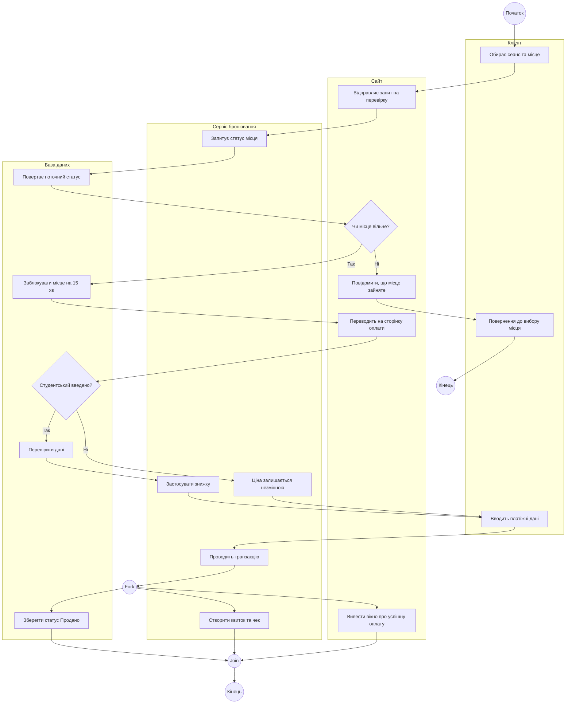
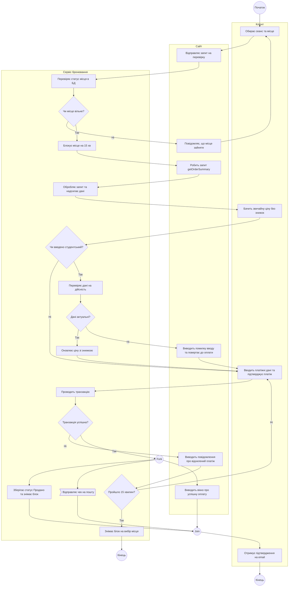

# Слід взаємодії з АІ — Лабораторна робота №4 (Activity Diagram)

Цей документ фіксує хронологічну історію постановки задач, ітеративного уточнення специфікації (`spec.md`), проведення аудиту та генерації артефактів за допомогою ШІ.

---

## Етап 1: Перша ітерація специфікації (`spec.md`) та первинний аудит

**Промпт студента (початкова чернетка логіки процесу власноруч):**
> ```markdown
> # УЧАСНИКИ:
> 1. Клієнт
> 2. Сайт 
> 3. Сервіс бронювання
> 4. База даних
> 
> ## РОЗГАЛУЖЕННЯ №1
> - Перевірка місця:
>   -
>   Чи це місце вільне? 
>   1. Якщо ні, то повідомити про те, що це місце вже зайняте і повенути клієнта до вибору місця або завершити потік.
>   2. Якщо так, то заблокувати місце для бронювання на 15 хвилин.
> 
> ## РОЗГАЛУЖЕННЯ №2
> - Опціональна студентська знижка:
>     -
> Чи введено дані студентського квитка?
> 1. Якщо ні, ціна залишається незмінною.
> 2. Якщо так, перевірити дані в базі даних та застосувати знижку.
> 
> ## ПАРАЛЕЛЬНА ГІЛКА:
> 1. <b>Гілка Бази даних</b>: зберегти фінальний статус квитка, а саме статус "Продано" та зняти блокування квитка.
> 2. <b>Гілка Сервіс</b>: створити електронний квиток та відправити на пошту клієнту чек про оплату.
> 3. <b>Гілка Сайт</b>: вивести на екран клієнту вікно про успішну оплату квитка.
> 4. Усі гілки сходяться у фінальний <b>Join</b> перед точкою завершення процесу.
> ```
> ось моє виконане проектування структури, якщо виявлені помилки або неточності то надай настанови по виправленню, якщо ні то переходимо до наступного кроку

**Аналіз та фідбек від AI (виявлені логічні прогалини):**
1. **Відсутність базового кроку між розгалуженнями:** Між застосуванням знижки (Розгалуження 2) та паралельною гілкою створення чеків зник сам обов'язковий крок «Оплата». Паралельні дії мають виконуватися лише *після* підтвердження транзакції.
2. **Висячі стани (Dead ends):** Зазначено, що при помилці вибору місця потрібно «повернути клієнта або завершити потік». Для Activity-діаграми потрібно визначити один точний шлях, щоб уникнути «дір» у процесі.
3. **Формалізація процесу:** Запропоновано переписати текст у вигляді послідовного сценарію (`spec.md`), де кожна дія чітко закріплена за конкретною доріжкою учасника (Swimlane).

---

## Етап 2: Друга ітерація `spec.md` та архітектурне рішення щодо Fork/Join

**Промпт студента (оновлена специфікація з виправленою логікою):**
> (Надано оновлену структуру, де додано блок "Оплата" перед паралельною гілкою та визначено чіткі дії для учасників).

**Відповідь AI:**
Підтверджено, що специфікація тепер повністю відповідає правилам «Definition of Done» для Activity-діаграми. Присутні всі ролі, є обробка помилки вибору місця, опціональна умова та коректне злиття (`Join`) після паралельних транзакційних дій. 

**Узгодження нотації (ADR):**
AI та студент погодили використання нотації **Mermaid** (`flowchart TD`). Для реалізації доріжок учасників (Swimlanes) було обрано використання блоків `subgraph`, що дозволяє нативно рендерити Activity-діаграму прямо в GitHub Markdown без використання сторонніх інструментів.

---

## Етап 3: Фіналізація та генерація коду Activity-діаграми

**Промпт студента:**
> переходимо (генерація згідно спеки)

**Згенерований артефакт AI (Mermaid Activity Diagram):**



---

## Етап 4: Аудит за відгуком викладача та складання плану виправлень

**Промпт студента:**
> (Надано відгук грейдера: аудиту узгодженості немає, доріжку БД прибрано але є проблеми з циклом, spec має бути написана власноруч, бракує getOrderSummary з Лаби 3, тощо). Проаналізувавши помилки, склади план дій та способи їх виконання.

**Відповідь AI (Аналіз відгуку та рекомендації до самостійного виправлення):**
Згідно з правилами курсу, фінальний текст специфікації має бути написаний тобою власноруч. На основі наданого відгуку грейдера виділено 4 ключові напрямки, які тобі потрібно самостійно доопрацювати у файлі `spec3.md`:

1. **Архітектурне обґрунтування:** Напиши пояснення, чому для цього бізнес-процесу обрано саме Activity-діаграму (з огляду на кількість учасників та паралельність), а не машину станів.
2. **Синхронізація з попередніми лабораторними:** Додай крок `getOrderSummary` (з Лаби 3) та логіку відхилення сфальсифікованого студентського квитка (з Лаби 2). 
3. **Виправлення логічних помилок:** Переробити гілку «місце зайняте» на повноцінний цикл із поверненням на початковий етап вибору (без висячих станів). Прибрати описи станів (наприклад, «ціна незмінна»), замінивши їх на дії або порожні переходи.
4. **Ускладнення циклу оплати:** Додати перевірку 15-хвилинного таймера при збої транзакції та чітко вказати, що генерація чека є асинхронним повідомленням без очікування відповіді.

Після самостійного внесення цих змін у текст, надай оновлений файл для фінального аудиту та кодогенерації.

---

## Етап 5: Перевірка власноруч оновленої специфікації та генерація фінального коду

**Промпт студента:**
> (Надано повністю написаний власноруч файл `spec3.md`, що імплементує всі пункти з плану Кроку 4).
> ось моя фінальна спека, перевір знову на наявність помилок і в разі їх відсутності переходимо до генерації

**Відповідь AI (Аудит оновленої специфікації та генерація коду):**
Наданий текст специфікації повністю відповідає вимогам лекції та зауваженням грейдера. Логічних помилок не виявлено. 
1. Додано архітектурне обґрунтування (ADR) та критерії прийняття безпосередньо у файл.
2. Процес успішно синхронізовано з Лабораторною №3 (додано запит `getOrderSummary` та показ базової ціни).
3. Вирішено проблему висячого стану при помилці вибору місця (тепер потік коректно повертається на початок).
4. Оновлено розгалуження студентської знижки: прибрано стани-дії та додано обробку недійсного (сфальсифікованого) квитка для узгодженості з Use Case Лабораторної №2.
5. Розгалуження №3 тепер містить вкладений цикл переривання за подією часу (вихід із процесу, якщо спливли 15 хвилин блокування).
6. Надсилання чека формалізовано як асинхронне повідомлення.

На основі узгодженої специфікації згенеровано фінальний код Activity-діаграми.


