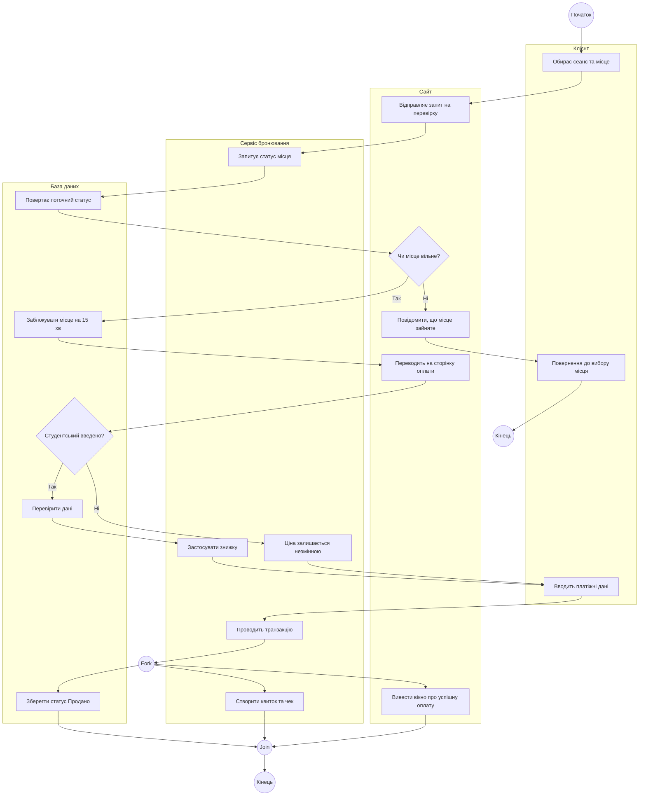
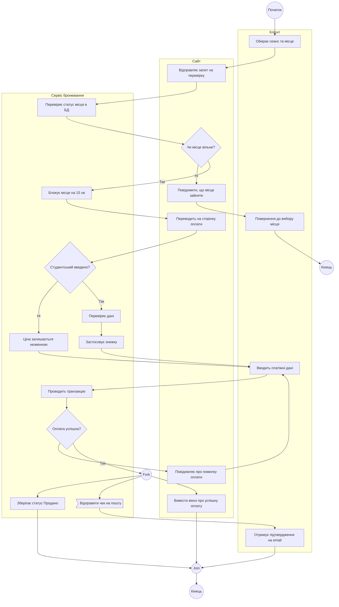

# Слід взаємодії з АІ — Лабораторна робота №4 (Activity Diagram)

Цей документ фіксує хронологічну історію постановки задач, ітеративного уточнення специфікації (`spec.md`), проведення аудиту та генерації артефактів за допомогою ШІ.

---

## Етап 1: Перша ітерація специфікації (`spec.md`) та первинний аудит

**Промпт студента (початкова чернетка логіки процесу власноруч):**
> ```markdown
> # УЧАСНИКИ:
> 1. Клієнт
> 2. Сайт 
> 3. Сервіс бронювання
> 4. База даних
> 
> ## РОЗГАЛУЖЕННЯ №1
> - Перевірка місця:
>   -
>   Чи це місце вільне? 
>   1. Якщо ні, то повідомити про те, що це місце вже зайняте і повенути клієнта до вибору місця або завершити потік.
>   2. Якщо так, то заблокувати місце для бронювання на 15 хвилин.
> 
> ## РОЗГАЛУЖЕННЯ №2
> - Опціональна студентська знижка:
>     -
> Чи введено дані студентського квитка?
> 1. Якщо ні, ціна залишається незмінною.
> 2. Якщо так, перевірити дані в базі даних та застосувати знижку.
> 
> ## ПАРАЛЕЛЬНА ГІЛКА:
> 1. <b>Гілка Бази даних</b>: зберегти фінальний статус квитка, а саме статус "Продано" та зняти блокування квитка.
> 2. <b>Гілка Сервіс</b>: створити електронний квиток та відправити на пошту клієнту чек про оплату.
> 3. <b>Гілка Сайт</b>: вивести на екран клієнту вікно про успішну оплату квитка.
> 4. Усі гілки сходяться у фінальний <b>Join</b> перед точкою завершення процесу.
> ```
> ось моє виконане проектування структури, якщо виявлені помилки або неточності то надай настанови по виправленню, якщо ні то переходимо до наступного кроку

**Аналіз та фідбек від AI (виявлені логічні прогалини):**
1. **Відсутність базового кроку між розгалуженнями:** Між застосуванням знижки (Розгалуження 2) та паралельною гілкою створення чеків зник сам обов'язковий крок «Оплата». Паралельні дії мають виконуватися лише *після* підтвердження транзакції.
2. **Висячі стани (Dead ends):** Зазначено, що при помилці вибору місця потрібно «повернути клієнта або завершити потік». Для Activity-діаграми потрібно визначити один точний шлях, щоб уникнути «дір» у процесі.
3. **Формалізація процесу:** Запропоновано переписати текст у вигляді послідовного сценарію (`spec.md`), де кожна дія чітко закріплена за конкретною доріжкою учасника (Swimlane).

---

## Етап 2: Друга ітерація `spec.md` та архітектурне рішення щодо Fork/Join

**Промпт студента (оновлена специфікація з виправленою логікою):**
> ```markdown
> # УЧАСНИКИ:
> 1. Клієнт
> 2. Сайт 
> 3. Сервіс бронювання
> 4. База даних
>     
> ## ПРОЦЕС
> 
>  ## **Початок процесу**
> - **Клієнт**: Обирає сеанс та натискає на бажане місце.
> - **Сайт**: Відправляє запит на перевірку вибраного місця.
> - **Сервіс бронювання**: Запитує статус місця у Бази даних.
> - **База даних**: Повертає поточний статус.
> 
> ## РОЗГАЛУЖЕННЯ №1
> - **Перевірка місця:**
>   -
>   Чи це місце вільне? 
>   1. Якщо ні, то повідомити про те, що це місце вже зайняте і повенути клієнта до вибору місця або завершити потік.
>   2. Якщо так, то заблокувати місце для бронювання на 15 хвилин.
> 
>   ## **Перехід до оформлення**
> - **Сайт**: Переводить Клієнта на сторінку оплати.
> 
> ## РОЗГАЛУЖЕННЯ №2
> - **Опціональна студентська знижка:**
>     -
> Чи введено дані студентського квитка?
> 1. Якщо ні, ціна залишається незмінною.
> 2. Якщо так, перевірити дані в базі даних та застосувати знижку.
> 
> ## **Оплата**
> - **Клієнт**: Вводить платіжні дані та підтверджує платіж.
> - **Сервіс бронювання**: Проводить транзакцію.
> 
> ## ПАРАЛЕЛЬНА ГІЛКА:
> 1. <b>Гілка Бази даних</b>: зберегти фінальний статус квитка, а саме статус "Продано" та зняти блокування квитка.
> 2. <b>Гілка Сервіс</b>: створити електронний квиток та відправити на пошту клієнту чек про оплату.
> 3. <b>Гілка Сайт</b>: вивести на екран клієнту вікно про успішну оплату квитка.
> 4. Усі гілки сходяться у фінальний <b>Join</b> перед точкою завершення процесу.
> 
> ## КІНЕЦЬ ПРОЦЕСУ
> ```
> ось оновлена спека, якщо не виявлено помилок, то переходимо далі

**Відповідь AI:**
Підтверджено, що специфікація тепер повністю відповідає правилам «Definition of Done» для Activity-діаграми. Присутні всі 4 ролі (що забезпечує трасування з Лабораторною №3), є обробка помилки вибору місця, опціональна умова та коректне злиття (`Join`) після паралельних транзакційних дій. 

**Узгодження нотації (ADR):**
AI та студент погодили використання нотації **Mermaid** (`flowchart TD`). Для реалізації доріжок учасників (Swimlanes) було обрано використання блоків `subgraph`, що дозволяє нативно рендерити Activity-діаграму прямо в GitHub Markdown без використання сторонніх інструментів.

---

## Етап 3: Фіналізація та генерація коду Activity-діаграми

**Промпт студента:**
> переходимо (генерація згідно спеки)

**Згенерований артефакт AI (Mermaid Activity Diagram):**



---

## Етап 4: Архітектурне ускладнення (Додавання циклу)

**Промпт студента:**
> Поточна модель описує лише ідеальний сценарій. Проаналізуй процес та запропонуй кілька архітектурних варіантів ускладнення для обробки нелінійних бізнес-ситуацій або збоїв.

**Аналіз від AI:**
Запропоновано 3 варіанти ускладнення для відходу від "тепличного" сценарію та демонстрації розуміння реальних бізнес-процесів:
1. Цикл обробки збою транзакції.
2. Інтеграція «Події часу» (переривання потоку по таймеру).
3. Асинхронний платіж (очікування відповіді від зовнішньої платіжної системи).

**Рішення студента:**
> Зупинимося на першому варіанті — додаванні циклу обробки збою транзакції. Онови логіку специфікації з урахуванням цього патерну.

**Відповідь AI:**
Оновлено специфікацію: додано Розгалуження №3 (Перевірка статусу оплати). Якщо платіж відхилено, процес не завершується, а через стрілку `backward` повертає Клієнта на форму введення платіжних даних, утворюючи життєздатний цикл переривання та повторення.

---

## Етап 5: Фінальна генерація коду (Mermaid) після всіх виправлень

**Промпт студента:**
> Згенеруй фінальний код діаграми на основі оновленої специфікації.

**Згенерований артефакт AI (Оновлена Mermaid-діаграма з циклом, 3 учасниками та повідомленням):**


