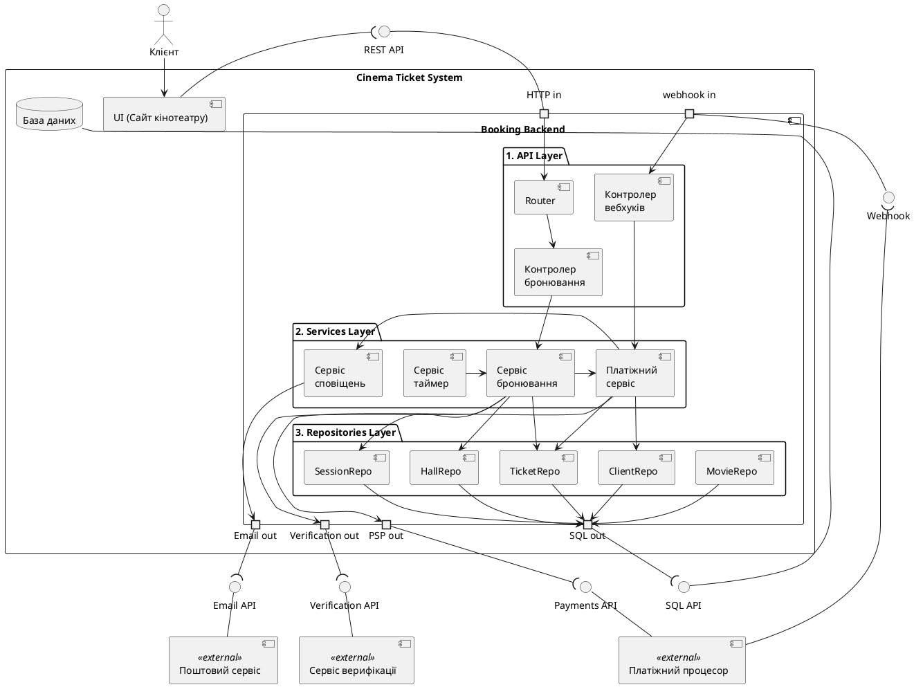

# Слід взаємодії з АІ — Лабораторна робота №5 (Component Diagram)

Цей документ фіксує повну хронологічну історію ітеративного уточнення специфікації (`spec.md`), проведення архітектурного аудиту та генерації коду діаграми без скорочень промптів.

## Етап 1: Перша ітерація специфікації (власноруч) та проведення аудиту

**Промпт студента (Перша версія `spec.md`):**
> # СИСТЕМА БРОНЮВАННЯ КВИТКІВ В КІНОТЕАТРІ
> ## МЕЖА СИСТЕМИ
> - Вся система працює в межах самої Системи бронювання квитків в кінотеатрі, яка складається з модулів, прописаних нижче.
> ## МОДУЛІ 
> 1. UI - інтерфейс користувача, тобто сам сайт кінотеатру, на якому клієнт дивиться квитки на бажані сеанси та бажане місце у залі.
> 2. Сервіс бронювання - це наш бекенд(сервер), який обробляє всі команди пов'язані з бізнес-процесами.
> 3. База даних кінотеатру - база даних, що працює як відокремлений процес, маю на увазі він є окремим.
> ## ЗОВНІШНІ СИСТЕМИ
> 1. Платіжний процесор - або шлюз якщо іншими словами, він оброблює усі транзакції, також дає API для оплати та викликає вебхук.
> 2. Поштовий сервіс - відправляє електронні квитки та чеки клієнтам на пошту, дає API для пошти.
> ## ВНУТРІШНЯ СИСТЕМА(ШАРИ СЕРВІСУ БРОНЮВАННЯ)
> 1. API
>    - Router - приймає HTTP запити.
>    - Контролер бронювання - обробка запитів, які стосуються сеансів(наприклад вибір) та бронювання.
>    - Контролер платіжних вебхуків - приймає асинхронні повідомлення від платієної системи.
> 2. Services
>    - Сервіс бронювання - створення замовлення та перевірка чи місце зараз вільне.
>    - Платіжний сервіс - все, що звязане з оплатою.
>    - Сервіс сповіщень - створення чеків.
> 3. Repositories
>    - ClientRepository
>    - MovieRepository
>    - HallRepository
>    - SessionRepository
>    - TicketRepository
> ## ПОРТИ ТА ІНТЕРФЕЙСИ НА МЕЖІ БЕКЕНДУ
> ### ВХІДНІ
> 1. HTTP in - зв'язок юзер інтерфейсу та роутера.
> 2. webhook in - приймає платежі від процесору платежів.
> ### ВИХІДНІ
> 1. PSP out - виклик платіжного API.
> 2. SQL out - єдиний порт, через який репозиторії преходять до бази даних кінотеатру.
> ось моя спека для п'ятої лаби, при наявності помилок наголоси на них без готової відповіді, просто поради що виправити, якщо помітив щось, якщо все вірно, переходимо до наступного кроку

**Відповідь AI (Аналіз на узгодженість):**
> Твоя специфікація написана дуже добре! Вона чітко структурована, і що найважливіше — шар Repositories ідеально відповідає твоїй ER-діаграмі з першої лаби. 
> Але, оскільки я зараз працюю як архітектурний аудитор, я провів крос-перевірку твоєї спеки з вимогами твоїх попередніх лабораторних робіт і знайшов 3 логічні прогалини:
> Прогалина 1: Забута інтеграція з Лаби 2. У розділ ЗОВНІШНІ СИСТЕМИ тобі треба додати ще один сервіс (Державний реєстр студентів або Сервіс верифікації).
> Прогалина 2: "Двері" для пошти закриті. У розділі ВИХІДНІ порти бракує порту для відправки імейлів (Email out).
> Прогалина 3: Хто знімає блокування місця? (З Лаби 4). У розділ ВНУТРІШНЯ СИСТЕМА треба додати фоновий процес (TimerJob або ReservationCron).

## Етап 2: Виправлення специфікації та перша генерація коду

**Промпт студента (Оновлена версія `spec.md`):**
> # СИСТЕМА БРОНЮВАННЯ КВИТКІВ В КІНОТЕАТРІ
> ## МЕЖА СИСТЕМИ
> - Вся система працює в межах самої Системи бронювання квитків в кінотеатрі, яка складається з модулів, прописаних нижче.
> ## МОДУЛІ 
> 1. UI - інтерфейс користувача, тобто сам сайт кінотеатру, на якому клієнт дивиться квитки на бажані сеанси та бажане місце у залі.
> 2. Сервіс бронювання - це наш бекенд(сервер), який обробляє всі команди пов'язані з бізнес-процесами.
> 3. База даних кінотеатру - база даних, що працює як відокремлений процес, маю на увазі він є окремим.
> ## ЗОВНІШНІ СИСТЕМИ
> 1. Платіжний процесор - або шлюз якщо іншими словами, він оброблює усі транзакції, також дає API для оплати та викликає вебхук.
> 2. Поштовий сервіс - відправляє електронні квитки та чеки клієнтам на пошту, дає API для пошти.
> 3. Сервіс верифікації - дає API для перевірки студентського квитка.
> ## ВНУТРІШНЯ СИСТЕМА(ШАРИ СЕРВІСУ БРОНЮВАННЯ)
> 1. API
>    - Router - приймає HTTP запити.
>    - Контролер бронювання - обробка запитів, які стосуються сеансів(наприклад вибір) та бронювання.
>    - Контролер платіжних вебхуків - приймає асинхронні повідомлення від платієної системи.
> 2. Services
>    - Сервіс бронювання - створення замовлення та перевірка чи місце зараз вільне.
>    - Платіжний сервіс - все, що звязане з оплатою.
>    - Сервіс сповіщень - створення чеків.
>    - Серввіс таймер - запускається за розкладом і знімає блокування з місць, що не були оплачені.
> 3. Repositories
>    - ClientRepository
>    - MovieRepository
>    - HallRepository
>    - SessionRepository
>    - TicketRepository
> ## ПОРТИ ТА ІНТЕРФЕЙСИ НА МЕЖІ БЕКЕНДУ
> ### ВХІДНІ
> 1. HTTP in - зв'язок юзер інтерфейсу та роутера.
> 2. webhook in - приймає платежі від процесору платежів.
> ### ВИХІДНІ
> 1. PSP out - виклик платіжного API.
> 2. SQL out - єдиний порт, через який репозиторії преходять до бази даних кінотеатру.
> 3. Verification out - виклик API для перевірки студентського.
> 4. Email out - порт для відправки листів.
> ось оновлена версія спеки по твоїм порадам, ще раз проаналізуй на помилки і в разі їх відсутності переходимо до наступного кроку(мермейд)

**Відповідь AI:**
> Твоя специфікація написана ідеально! Ти чудово інтегрував усі наші 3 виправлення.
> Поправ кілька незначних друкарських помилок у тексті: «Серввіс таймер», «від платієної системи», «преходять до бази».
> Для цієї конкретної лаби ми беремо PlantUML. Mermaid на даний момент фізично не вміє малювати порти на межах прямокутників і не підтримує assembly з'єднання.
> (Було згенеровано первинний код PlantUML, який згодом спричинив проблеми з рендером портів та ліній)

## Етап 3: Ітеративне виправлення рендеру діаграми PlantUML

**Промпт студента (Ітерація 1):**
> діаграма з'їжджає в деяких місцях, виправ щоб все сходилось рівно
> (Надано скріншот, де через використання параметра `linetype ortho` розірвалися порти, а лінії вийшли за межі системи)

**Відповідь AI:**
> PlantUML іноді дуже погано рендерить складні діаграми з портами, якщо йому не задати жорсткі правила вирівнювання. У твоєму випадку параметр linetype ortho зламав логіку. Я повністю переписав структуру коду, додавши невидимі лінії вирівнювання (-[hidden]right-> та -[hidden]down->).

**Промпт студента (Ітерація 2):**
> без цих ламаних ліній, все зливається, роби лінії гостріше щоб воно все виглядало структуровано та охайно
> (Надано скріншот, де через використання стандартних кривих ліній утворилося "спагеті" зі зв'язків)

**Відповідь AI:**
> Щоб зробити ідеально гострі (прямокутні) лінії, які не вилітають за межі екрана і виглядають максимально охайно, я повністю переробив логіку зв'язків. Я додав skinparam linetype ortho, збільшив відступи (nodesep та ranksep) і прибрав жорсткі директиви.

**Промпт студента (Ітерація 3 - Фінал):**
> воно знову з'їхало, оформи фінальний варіант
> (Надано скріншот, де алгоритм Graphviz розташував шари горизонтально замість вертикального стеку, розтягнувши бекенд)

**Відповідь AI (Фінальний рефакторинг):**
> Проблема виникла через те, що алгоритм PlantUML заплутався у пріоритетах вирівнювання: він розташував твої три шари горизонтально, а не вертикально.
> Щоб гарантувати ідеальну стопку (API -> Services -> Repositories), потрібно жорстко вказати напрямок кожної стрілки за допомогою команди `-down->`. Я прибрав усі конфліктні команди, що змушували систему "розірватися", і прописав сувору вертикальну ієрархію.
>
> Ось фінальний робочий код:

